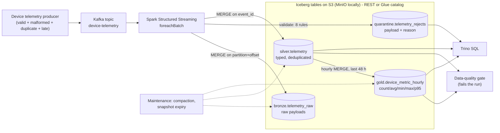

# streaming-data-platform

A streaming lakehouse for IoT device telemetry: **Kafka → Spark Structured Streaming → Apache Iceberg
(bronze / silver / gold) on S3 → Trino**, with a quarantine for bad records, idempotent writes that survive
replays, a data-quality gate, Iceberg table maintenance, Kubernetes manifests (Strimzi, Spark Operator) and a
Terraform AWS variant (MSK Serverless, EMR Serverless, Glue, S3).

It's a personal project rebuilding, with today's open lakehouse stack, the kind of pipelines I built on Nokia's
Motive Analytics Stack for telecom operators (Hive/Impala/Oozie batch jobs, Kafka ingestion). It isn't code from a
former employer.



## Results

_Filled from the CI end-to-end run (see the **e2e** job summary on the latest Actions run)._

## What it demonstrates

| Problem in real pipelines | How it's handled here |
|---|---|
| Producers resend; Spark retries micro-batches; checkpoints get lost | every write is an idempotent `MERGE` (bronze/quarantine on Kafka partition+offset, silver on `event_id`), so CI deletes the checkpoint, **replays the whole topic** and asserts nothing doubled |
| Bad records crash jobs or silently disappear | 8 declarative validation rules; failures go to `quarantine` with the raw payload, offset and the **reason**, and are queryable in Trino |
| Late data makes aggregates wrong | gold is rebuilt for a sliding 48-hour event-time window with `MERGE`, so late events update the hour they belong to |
| "The job succeeded" but the numbers are wrong | `dq_checks` reconciles gold against silver per device/metric/hour, checks duplicates, null keys and reject rate, and exits non-zero |
| Streaming creates thousands of small files | daily Iceberg maintenance: `rewrite_data_files`, delete-file rewrite, `expire_snapshots`, `rewrite_manifests` |
| Hive-style tables are hard to change and to query concurrently | Iceberg: ACID commits, hidden partitioning (`days(event_ts)`, `metric`), schema evolution, time travel (`$snapshots`) |

## Run it

Needs Docker, Java 17 and Python 3.10-3.12.

```bash
pip install -r requirements-dev.txt
pytest -q                                   # unit tests (local Spark, no Docker)
bash scripts/e2e.sh                         # full stack + 20,000 events + replay + maintenance, with assertions
trino --server localhost:8080 --catalog lake -f sql/analytics.sql   # analyst queries
docker compose down -v
```

Step by step instead of `e2e.sh`:

```bash
docker compose up -d --wait kafka minio rest trino
export PYTHONPATH=$PWD AWS_ACCESS_KEY_ID=admin AWS_SECRET_ACCESS_KEY=password AWS_REGION=us-east-1
python -m jobs.init_tables
python producer/telemetry_producer.py --events 20000 --rate 500      # or no --rate for a burst
python -m jobs.stream_ingest                                          # continuous, 10 s micro-batches
python -m jobs.build_gold --hours 48
python -m jobs.dq_checks
python -m jobs.maintenance --retain-days 7
```

## Layout

```
producer/   telemetry generator (realistic devices + controlled bad/duplicate/late records, writes expectations)
sdp/        shared library: settings, Spark/Iceberg session, schema + DDL, validation rules, transforms
jobs/       init_tables, stream_ingest, build_gold, dq_checks, maintenance
tests/      unit tests for parsing, every rejection reason, dedupe, late data, aggregation, producer
scripts/    e2e.sh (CI end to end), verify_e2e.py (exact-count assertions through Trino)
sql/        analyst queries (low battery, RSSI by site, rejects, ingestion lag, time travel)
k8s/base/   Strimzi Kafka (KRaft), Iceberg REST, SparkApplication + ScheduledSparkApplications (gold, DQ, maintenance)
terraform/aws/  MSK Serverless (IAM auth), EMR Serverless, Glue databases, S3 lake bucket, least-privilege job role
docs/       design decisions, operations runbook
```

## Production path

- **Kubernetes:** `k8s/base` (Strimzi Kafka with 3 KRaft nodes and `min.insync.replicas=2`, Spark Operator jobs,
  Iceberg REST catalog). The image (`Dockerfile`) bakes in the Kafka/Iceberg/S3 jars. Credentials come from IRSA, so
  there are no keys in the cluster.
- **AWS managed:** `terraform/aws` (MSK Serverless + EMR Serverless + Glue catalog + S3). The same jobs run with
  `ICEBERG_CATALOG_TYPE=glue`. Athena or Trino query the tables.
- Both paths are validated in CI (`terraform validate`, `kubeconform` with the Strimzi and Spark Operator CRD schemas,
  image build); they are not applied to a live account by CI.

More: [`docs/design.md`](docs/design.md) and [`docs/runbook.md`](docs/runbook.md).
