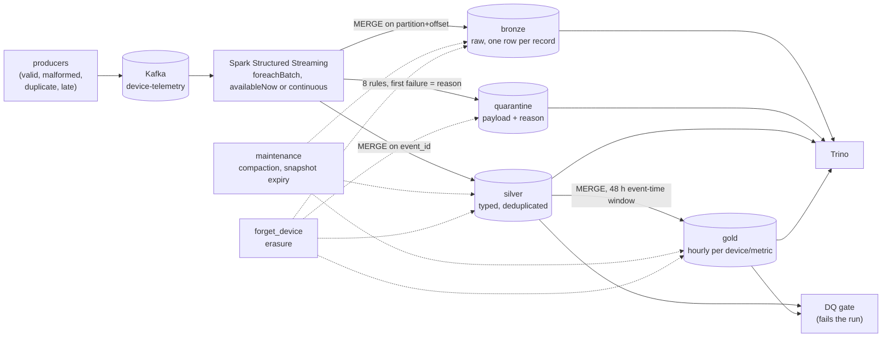

# streaming-data-platform: architecture

Decisions are in [`design.md`](design.md) and operations in [`runbook.md`](runbook.md). This page is the system view.

## 1. Context

Device telemetry arrives as an endless, messy stream: resends, records late by hours, malformed payloads, values that can't be true. Analysts need correct numbers, operations need to replay after an incident without double counting, and compliance needs to be able to delete one customer's data for real. A medallion lakehouse on open table formats does all three.

## 2. Layers

| Layer | Holds | Written by | Key | Why |
|---|---|---|---|---|
| bronze | Every Kafka record, raw | `MERGE` on (partition, offset) | Kafka position | The replayable source of truth inside the lake; idempotent under any replay |
| quarantine | Records failing validation, with the reason | `MERGE` on (partition, offset) | Kafka position | Bad data is visible and queryable, never silently dropped, never crashing the job |
| silver | Typed, valid, deduplicated events | `MERGE` on `event_id` | Event id | Resends and replays don't double count |
| gold | Hourly count/avg/min/max/p95 per device and metric | `MERGE` over the last 48 h of event time | (device, metric, hour) | Late events update the hour they belong to |

## 3. Correctness under failure

| Failure | What keeps the numbers right | Proven by |
|---|---|---|
| Producer resends (at-least-once) | silver `MERGE` on `event_id` | 388 resends in the e2e, 0 duplicates in silver |
| Spark retries a micro-batch | Every write is an idempotent `MERGE` | — |
| The checkpoint is lost | Same: delete it, replay the whole topic, nothing doubles | The e2e deletes the checkpoint and replays 20,000 records; the 7 exact assertions still pass |
| Late data | gold rebuilt over a sliding 48 h event-time window | 409 late events, gold reconciles with silver in every hour |
| "The job succeeded but the numbers are wrong" | DQ gate: gold reconciled against silver, duplicates, null keys, reject rate; exits non-zero | Every run |
| Small files from streaming | Daily compaction, delete-file rewrite, snapshot expiry, manifest rewrite | The e2e verifies again after maintenance |

## 4. Erasure: deleting data from an immutable lake

An Iceberg `DELETE` writes a new snapshot. The deleted rows stay in the old data files, and anyone can still read them with `FOR VERSION AS OF <old snapshot>`. In the merge-on-read silver table, a `DELETE` doesn't even rewrite the data files: it adds position-delete files.

`jobs/forget_device.py` does the whole job, per table:
1. `DELETE` the device's rows. Bronze and quarantine are matched on the Kafka key and the raw payload: the parsed `device_id`, or the raw text for malformed JSON. Silver and gold are matched on `device_id`.
2. `rewrite_data_files` with every file rewritten and delete files folded in, so no live data file still contains the rows.
3. `expire_snapshots`, keeping only the current snapshot, so nothing references the old files.
4. Orphan removal (the Action API, listing through Iceberg's own S3 client): it deletes files that no snapshot references, such as those left by writes that never committed. The SQL procedure refuses intervals under 24 hours, and the default Hadoop listing has no `s3` filesystem here. If listing isn't available, the step is skipped and the report says so. The erased rows are gone either way, because step 3 already deleted every file that only the expired snapshots used.
5. A check that no remaining snapshot returns a row for the device.

`scripts/verify_forget.py` then checks from the outside, through Trino:
- zero rows for the device in all four tables;
- every other device's rows untouched (totals fall by exactly the device's rows);
- time travel to the pre-erasure snapshot refused.

Run it with the stream stopped. Orphan removal can't tell an uncommitted file from a concurrent writer apart from garbage, which is why Iceberg's default keeps files younger than 3 days.

What this doesn't cover, by design: Kafka still holds the records until retention expires (set retention to the erasure deadline, or use per-tenant topics), and backups or snapshots of the object store need their own policy.

## 5. Deployment paths

| Path | Components |
|---|---|
| Local / CI | Docker Compose: Kafka (KRaft), SeaweedFS as S3, Iceberg REST catalog, Trino; Spark in the runner |
| Kubernetes | Strimzi Kafka (3 KRaft nodes, `min.insync.replicas=2`), Spark Operator jobs, Iceberg REST catalog; credentials via IRSA |
| AWS managed | MSK Serverless, EMR Serverless, Glue catalog, S3; the same jobs with `ICEBERG_CATALOG_TYPE=glue`; Athena or Trino |

The Kubernetes and AWS paths are validated in CI (kubeconform with the Strimzi and Spark Operator CRD schemas, `terraform validate`, image build), not applied.

## 6. Testing

| Level | What |
|---|---|
| Unit (Spark local) | Parsing, every rejection reason, dedupe, late data, aggregation, the producer |
| End to end (CI) | 20,000 records: exact counts per layer and per rejection reason; again after a full replay; again after maintenance; then erasure of one device, checked through Trino including time travel |

## 7. Next steps

- Schema evolution with a data contract: additive changes evolve the table, incompatible ones go to quarantine with their own reason.
- Exactly-once into downstream systems (Kafka transactions, or the outbox pattern from gold).
- Erasure at scale: batch many erasure requests per run, and track each request to completion for audit.
